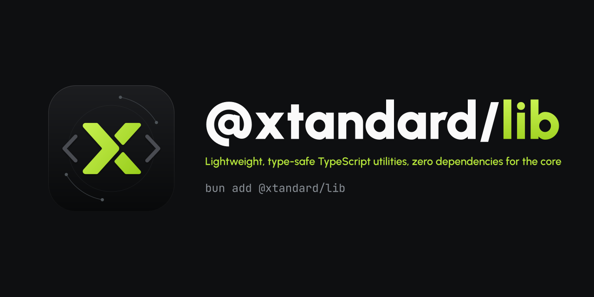

# Brand

The @xtandard/lib mark is the family's lime **X**: a big `>` chevron, a lower-right stroke and a
full-height upper-right arm. It is the base the siblings build on. Each of them shortens that arm
and stands its emblem on it (audit a shield, links a chain link, entitlements a gauge, flags a flag,
webhooks a hook); the base library keeps the arm whole and carries no emblem. It sits on the
family's near-black rounded tile between grey `<` `>` brackets with faint orbit lines.



The mark comes as an app icon, a bare symbol and wordmark lockups. Everything lives in
[`assets/`](../assets/) at the repository root (not in `docs/`, which is published to npm). The SVGs
are the masters, and every PNG and ICO is built from them. The masters are clean geometry: rounded
polygons and linear gradients, no filters except the soft shadow in the app icon, no embedded fonts
or images. They are generated by [`scripts/brand/`](../scripts/brand/), so a change to the mark, a
colour, the tagline or a lockup's layout is a code change, not a hand edit of the SVGs.

## Files

| File                                                                  | What it is                                                                                                                          | Use it for                                                                                                    |
| --------------------------------------------------------------------- | ----------------------------------------------------------------------------------------------------------------------------------- | ------------------------------------------------------------------------------------------------------------- |
| `logo.svg`                                                            | App icon: the symbol and grey `<` `>` brackets on a near-black rounded square with faint orbit lines                                | Avatars and app-icon slots only (never shown as a logo on a page); the master for the Apple touch icon        |
| `symbol.svg`, `symbol-light.svg`                                      | The symbol alone, transparent, no tile: lime for dark surfaces (`symbol.svg`) and a deeper lime for light ones (`symbol-light.svg`) | Any standalone mark in a UI (one per theme), inline UI                                                        |
| `lockup-horizontal-dark.svg`                                          | Symbol + wordmark, `@xtandard/` in near-white                                                                                       | Headers on dark backgrounds: the README in GitHub dark mode, the docs site in dark mode                       |
| `lockup-horizontal-light.svg`                                         | Symbol + wordmark, `@xtandard/` in ink, deeper lime                                                                                 | Headers on light backgrounds: the README in GitHub light mode, npm, the docs site in light mode               |
| `lockup-stacked-{dark,light}.svg`                                     | Symbol left, `@xtandard/` over `lib`                                                                                                | Square-ish slots: the docs site's home hero (one per theme), slides, stickers, sidebars                       |
| `monochrome-white.svg`, `monochrome-black.svg`                        | One-colour horizontal lockup                                                                                                        | Photos and busy backgrounds (white); print and engraving (black)                                              |
| `favicon.svg`, `favicon.ico` (16/32/48), `apple-touch-icon.png` (180) | Favicon set: the symbol, larger, on the flat ink square, without orbits, brackets or shadow (they do not survive 16 px)             | Browser tabs: the docs site                                                                                   |
| `social.svg`, `social.png` (1280×640)                                 | Social card: icon, wordmark, tagline, `bun add` line                                                                                | The GitHub social preview (Settings → General → Social preview, uploaded by hand), the docs site's `og:image` |

**SVG only where people see the mark, and no tile on a page.** Every logo, lockup and icon shown on a page (the README,
the docs site) is one of the SVGs above, and a standalone mark is the transparent symbol, never the
tiled `logo.svg`. The tile appears only where an app-icon shape is expected: the favicon set, the Apple
touch icon and the social card. There are exactly three rasters, each because a format needs
one and nobody sees it as an image on a page: `social.png` (`og:image` must be a raster),
`favicon.ico` and `apple-touch-icon.png` (`<head>` fallbacks). Don't add PNG copies of the logo or
lockups.

Regenerate the masters, then rebuild the three rasters from them:

```sh
bun run brand:masters  # uv run scripts/brand/build.py: writes every SVG in assets/
bun run brand:assets   # sh scripts/brand-assets.sh: rsvg-convert (librsvg) + magick (ImageMagick 7), oxipng when installed
bun run brand:check    # the three rasters present, site/public copies equal to assets/ (part of bun run check)
```

`brand-assets.sh` also copies the favicon set and `social.png` into `site/public/`, so the docs site
serves them from its own origin.

### The generator

`scripts/brand/build.py` is a [uv](https://docs.astral.sh/uv/) script: its inline metadata declares
fontTools and uharfbuzz, so `uv run` needs no venv or install step. On its first run it downloads the
variable `Urbanist[wght].ttf` and `JetBrainsMono[wght].ttf` from google/fonts into
`scripts/brand/fonts/`, which is gitignored: the fonts are never committed. Its output is
deterministic, so rerunning it on an unchanged checkout leaves `git status` clean. It is the
generator of the newer siblings (xtandard-audit, xtandard-links), with the emblem taken off the arm.

| File         | What it holds                                                                                                                                             |
| ------------ | --------------------------------------------------------------------------------------------------------------------------------------------------------- |
| `mark.py`    | The symbol's geometry: the X grid (height, slope, stroke width, gap, the arm's top)                                                                       |
| `build.py`   | The palette, the app icon (surface, rim, orbits, brackets, shadow), the favicon, the lockups, the monochrome files and the social card (tagline, command) |
| `text.py`    | Instances a variable font at a weight, shapes text with HarfBuzz and returns its outline as SVG path data; measures how far a text descends               |
| `geom.py`    | Rounded polygons (arcs at each corner) and line intersections                                                                                             |
| `palette.py` | Prints the OKLCH and contrast values of the palette table below (`python3 scripts/brand/palette.py`, no dependencies)                                     |

### Where each file goes

- **README header** (the README ships to npm, which does not ship `assets/`): a `<picture>` that
  picks the dark or light horizontal lockup with `prefers-color-scheme`, by absolute
  `raw.githubusercontent.com` URL so it renders on npm as well as GitHub:

  ```html
  <p align="center">
    <picture>
      <source
        media="(prefers-color-scheme: dark)"
        srcset="
          https://raw.githubusercontent.com/xantiagoma/xtandard/main/assets/lockup-horizontal-dark.svg
        "
      />
      
    </picture>
  </p>
  ```

  npm ignores `<source>` and shows the light lockup on its white page, which is the right one.

- **Docs site** (Starlight, `site/astro.config.ts`): `logo: { dark: lockup-horizontal-dark.svg,
light: lockup-horizontal-light.svg, replacesTitle: true }`, `favicon: favicon.svg`, plus `head`
  entries for `favicon.ico` (with `sizes="16x16 32x32 48x48"`), `apple-touch-icon.png` and
  `og:image` = `social.png` by absolute URL. The home page's hero image is the stacked lockup, per theme: `image: { dark: lockup-stacked-dark.svg, light: lockup-stacked-light.svg }` (no tile).
- **Favicon order** in any HTML head: `favicon.ico` (with `sizes`) first, then `favicon.svg`
  (`type="image/svg+xml"`, which modern browsers prefer), then `apple-touch-icon.png`.
- **Social preview**: `social.png`.

## Why no emblem

The previous raster logo was the bare X between brackets with a small `TS | </>` chip under it. The
family's icons carry no chips, and the chip's text is unreadable below 64 px, so it is gone. What it
said, "a TypeScript library", is now said by the wordmark (`@xtandard/lib`, the npm name) and by the
social card's `bun add` line. The X itself stays bare on purpose: every sibling is "the X plus an
emblem on its arm", so the X without one reads as the shared base they all start from. A `{ }` glyph
on the arm was considered and dropped: braces are two thin open strokes that blur into the arm at
32 px, and the icon already frames the X in `<` `>`.

## Wordmark

`@xtandard/lib` in **Urbanist** Black (900), tracking −1.2%, kerned by HarfBuzz, converted to paths:
the SVGs need no font. `@xtandard/` is `xt-paper` on dark and `xt-ink` on light; `lib` is always the
lime gradient. It follows the siblings' split (`xtandard-` + `audit`): the neutral part is the
family, the lime part is the package. It is the npm name, so it says what to install. The same face,
weight and tracking as the siblings' wordmarks. The social card adds Urbanist SemiBold (600) for the
tagline and **JetBrains Mono** Regular for the command.

Unlike the siblings' wordmarks, this one reaches below the baseline (`@` and `/`). The horizontal
lockup's canvas grows by that descent, and the stacked lockup opens its line pitch so the `@` clears
`lib`'s ascenders.

Licence: both fonts are under the SIL Open Font License 1.1. The SVGs contain glyph outlines (artwork
made with the font), not the font software, so the OFL's conditions on distributing the font do not
apply to them. Credit (also in `NOTICE`): Urbanist, Copyright 2021 The Urbanist Project Authors
(https://github.com/coreyhu/Urbanist); JetBrains Mono, Copyright 2020 The JetBrains Mono Project
Authors (https://github.com/JetBrains/JetBrainsMono).

## Palette

Lime on charcoal, the family's control-plane palette (shared with audit, links, entitlements, flags
and webhooks; xtandard-image is the blue exception). The docs site's accent colours in
`site/src/styles/brand.css` are the same lime family.

| Token           | Hex       | OKLCH                      | Role                                                                | Contrast on white / on ink |
| --------------- | --------- | -------------------------- | ------------------------------------------------------------------- | -------------------------- |
| `xt-lime-hi`    | `#C8F150` | `oklch(90.0% 0.188 122.6)` | Top left of the symbol gradient, top of `lib` on dark               | 1.30 / 14.53               |
| `xt-lime`       | `#B4E43A` | `oklch(85.6% 0.195 124.5)` | Accent on dark surfaces (the social-card tagline)                   | 1.49 / 12.68               |
| `xt-lime-word`  | `#A2D424` | `oklch(80.6% 0.194 125.4)` | Bottom of `lib` on dark                                             | 1.75 / 10.78               |
| `xt-lime-deep`  | `#97CC1B` | `oklch(78.0% 0.194 126.5)` | Bottom right of the symbol gradient                                 | 1.91 / 9.87                |
| `xt-lime-light` | `#9FD12A` | `oklch(79.7% 0.190 125.8)` | Top left of the symbol gradient on light surfaces                   | 1.81 / 10.46               |
| `xt-lime-ink`   | `#5E900C` | `oklch(59.5% 0.157 130.2)` | Bottom right of the symbol gradient on light surfaces               | 3.84 / 4.92                |
| `xt-lime-text`  | `#6FA514` | `oklch(65.9% 0.171 129.6)` | Top of `lib` on light                                               | 2.97 / 6.36                |
| `xt-lime-dark`  | `#4A7A0B` | `oklch(52.5% 0.141 132.0)` | Accent on light surfaces (links, buttons), bottom of `lib` on light | 5.15 / 3.67                |
| `xt-ink`        | `#101113` | `oklch(17.7% 0.004 264.5)` | Icon surface (flat, favicon), `@xtandard/` on light                 | 18.89 / —                  |
| `xt-night`      | `#0E0F11` | `oklch(16.8% 0.004 264.4)` | Social-card background                                              | 19.18 / 1.02               |
| `xt-surface`    | `#1C1D20` | `oklch(23.1% 0.006 271.2)` | Top of the app icon's surface gradient                              | 16.85 / 1.12               |
| `xt-bracket`    | `#4A4C51` | `oklch(41.6% 0.009 268.4)` | The `<` `>` brackets in the app icon                                | 8.59 / 2.20                |
| `xt-orbit`      | `#4E5459` | `oklch(44.2% 0.011 243.0)` | Orbit lines and dots in the app icon                                | 7.67 / 2.46                |
| `xt-slate`      | `#8B9198` | `oklch(65.4% 0.013 252.1)` | Secondary text on ink (the social-card command)                     | 3.18 / 5.94                |
| `xt-paper`      | `#FAFAFA` | `oklch(98.5% 0 0)`         | `@xtandard/` on dark                                                | 1.04 / 18.10               |

Text accents: on light surfaces use `xt-lime-dark` (AA for body text); on dark surfaces use `xt-lime`
(AAA). Every other lime is an artwork colour: never set body text in it on white. The light lockups
swap the symbol to `xt-lime-light` → `xt-lime-ink` and `lib` to `xt-lime-text` → `xt-lime-dark`,
because the dark-surface lime is under 2:1 on white.

All gradients are linear, light at the top left and deep at the bottom right, as if lit from the top
left: the symbol across its bounding box, `lib` from the top of its ascenders to the baseline, and the
icon surface `#1C1D20` → `#08090A` top to bottom with a 4-unit white rim at 14% → 3% opacity.

## Geometry

The X is drawn on a grid where it is 260 units high and every diagonal runs 0.9 units across per unit
down (a little steeper than 45°, like the siblings). Every stroke is 92 units wide measured
horizontally, and the lower stroke and the arm sit 26 units (horizontally) off the chevron's outer
edges. The arm runs to the X's top. The symbol is 326 × 260 units (`symbol.svg`).

- **App icon**: the symbol is 520 units wide (scaled 1.595, the siblings' width) and centred; the
  brackets are 196 high, 92 deep, 30 thick with round caps and joins, centred on the X's middle,
  their points 130 units from the edges. The orbit circle (r 350) and arcs (r 422) are the family's.
  Corner radius 224 of 1024 (21.9%).
- **Favicon**: the symbol 840 units wide on the flat `xt-ink` square, same corner radius.
- **Horizontal lockup**: the symbol 96 units high; the wordmark's baseline is the X's bottom, its
  x-height half the X's height, starting 22% of that height after the symbol. The canvas extends
  below by the `@`'s descent.
- **Stacked lockup**: the symbol 205 units high; `lib`'s baseline is the X's bottom, x-height 27% of
  the height, `@xtandard/` one line pitch above it.

**Clear space**: keep a quarter of the symbol's height free on every side of the symbol or lockup.
The app icon needs no clear space inside its square; outside it, keep 10% of its width.

**Minimum sizes**: app icon 48 px (use the favicon set below that, down to 16 px), symbol 16 px high,
horizontal lockup 24 px high (about 170 px wide), stacked lockup 48 px high.

## Do and don't

Do:

- Use the dark lockup on dark backgrounds and the light lockup on light ones; on GitHub, switch with
  `<picture>` and `prefers-color-scheme`.
- Use the app icon wherever a square avatar is expected, and the favicon set below 48 px.
- Use the monochrome lockups on photos, coloured backgrounds or in one-colour print.
- Reference the files by absolute URL outside the repository (npm, other sites).

Don't:

- Recolour the symbol (no blue: that is xtandard-image's colour), swap gradient directions or flatten
  the gradients into one lime, except in the monochrome files.
- Put the dark-surface lime symbol or `lib` on white: it is under 2:1. Use the light lockup.
- Set the wordmark in another font, or as live text in a different weight.
- Stretch, rotate, outline or add effects (glow, bevel, extra shadows) to the symbol.
- Put an emblem on the arm: emblems belong to the products built on the library.
