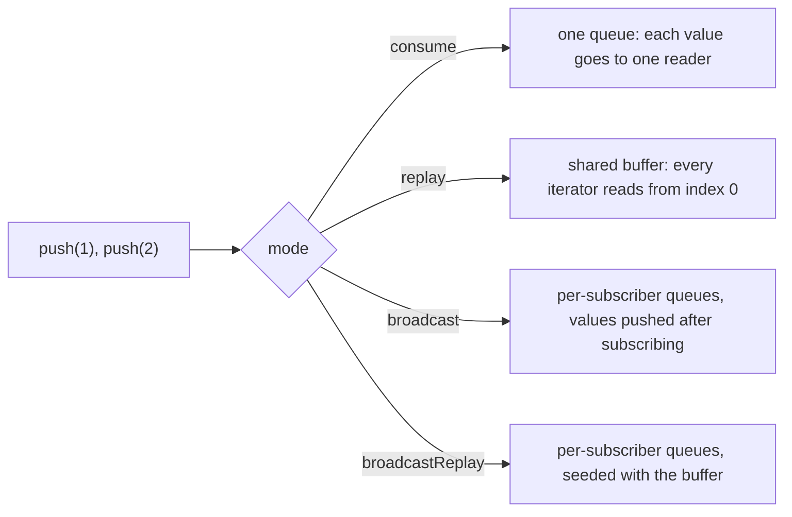

These are building blocks for async code: a typed delay, a promise you settle from outside, a push-based
async iterable, and helpers for values that may or may not be a Promise. Reach for them when you connect
callbacks or events to `async`/`await`, or when you stream values between parts of a program.

```ts
import {
  wait,
  Completer,
  collect,
  asyncOf,
  AsyncChannel,
  resolveMaybePromise,
  chainMaybePromise,
  type MaybePromise,
} from "@xtandard/lib";
```

## `wait`

`wait(ms)` is a promise-based `setTimeout`. Pass a second argument and the promise resolves with that
value, keeping its type.

```ts
await wait(250); // resolves with undefined after 250 ms

const value = await wait(100, { ok: true as const });
value; // { ok: true }
```

It's handy in tests, retries and backoff loops, and for faking latency in mocks:

```ts
const fakeApi = { getUser: (id: string) => wait(50, { id, name: "Ada" }) };
```

`wait` cannot be cancelled. To time out an operation, race it against a promise or use an `AbortSignal`.

## `Completer`

A `Completer<T, E>` is a Promise you settle from outside: create it, hand `completer.promise()` to whoever
waits, and call `resolve` or `reject` later from a callback, an event handler or another task.

```ts
const ready = new Completer<string, Error>();

socket.addEventListener("open", () => ready.resolve("connected"));
socket.addEventListener("error", () => ready.reject(new Error("socket failed")));

const status = await ready.promise(); // "connected"
```

`resolve` also accepts a promise (`MaybePromise<T>`), which the completer then follows.

Its methods are `resolve(value)`, `reject(reason)`, `promise()` and `reset()`. `reset()` replaces the
promise with a new pending one, so you can use the same completer again:

```ts
const tick = new Completer<number>();

tick.resolve(1);
await tick.promise(); // 1

tick.reset();
tick.resolve(2);
await tick.promise(); // 2
```

:::caution
The completer follows normal Promise rules: after the first `resolve` or `reject`, more calls do nothing
until you call `reset()`. `reset()` does not settle the old promise, so anything still awaiting the
previous `promise()` waits forever. Settle it before you reset.
:::

## `collect`

`collect(source)` reads an iterable to the end and returns its values as an array. It is
[sync/async-adaptive](@BASE@/guides/sync-async-adaptive/): a sync `Iterable` gives you `T[]` immediately,
and an `AsyncIterable` gives you `Promise<T[]>`.

```ts
collect(new Set([1, 2])); // [1, 2], no await

async function* pages() {
  yield 1;
  yield 2;
}
await collect(pages()); // [1, 2]
```

`collect` reads the whole source, so don't use it on an infinite generator.

## `asyncOf`

`asyncOf(...values)` is an async version of `Array.of`: an `AsyncGenerator` that yields its arguments in
order. Use it to feed fixed values to code that expects an async iterable, for example in tests.

```ts
for await (const n of asyncOf(1, 2, 3)) {
  console.log(n); // 1, 2, 3
}

await collect(asyncOf("a", "b")); // ["a", "b"]
```

## `AsyncChannel`

`AsyncChannel<T, TReturn>` is a push-based `AsyncIterable`. Producers call `push`, and consumers read with
`for await`. It is like a `Completer` for a stream of values: `push(value)` yields an item, `close(returnValue?)`
(or its alias `resolve(returnValue)`) ends the iteration, and `reject(error)` makes the consumer's `for await` throw.

```ts
const channel = AsyncChannel.create<string>();

const consumer = (async () => {
  for await (const line of channel) console.log(line);
  console.log("done");
})();

channel.push("hello");
channel.push("world");
channel.close();

await consumer; // hello, world, done
```

When a consumer is waiting, `push` hands the value straight to it. When none is waiting, the value is
buffered until one asks.

### Modes

There is no public constructor. Choose the mode with a static factory:

| Factory                          | Mode            | Who receives a value                                                                        |
| -------------------------------- | --------------- | ------------------------------------------------------------------------------------------- |
| `AsyncChannel.create()`          | consume         | One consumer. Each value is removed when read.                                              |
| `AsyncChannel.replay()`          | replay          | Every iteration, from the first value. Iterations can run one after another.                |
| `AsyncChannel.broadcast()`       | broadcast       | Every consumer subscribed when the value is pushed.                                         |
| `AsyncChannel.broadcastReplay()` | broadcastReplay | Every consumer. A consumer that subscribes late gets all past values first, then live ones. |



**consume** is a work queue. A second loop over the same channel gets nothing, because the first loop
already took the values. If two consumers run at the same time, they split the values between them.

```ts
const jobs = AsyncChannel.create<number>();
jobs.push(1);
jobs.push(2);
jobs.close();

await collect(jobs); // [1, 2]
await collect(jobs); // []: already consumed
```

**replay** keeps every value. Each new iteration starts from the beginning, then waits for new pushes until
the channel closes.

```ts
const log = AsyncChannel.replay<number>();
log.push(1);
log.push(2);
log.close();

await collect(log); // [1, 2]
await collect(log); // [1, 2]
```

**broadcast** is pub/sub for consumers that run at the same time. A consumer only sees values pushed after
it subscribed (that is, after its `for await` started).

```ts
const events = AsyncChannel.broadcast<number>();
events.push(0); // nobody is subscribed: no consumer receives it

const a = collect(events); // subscribes now
const b = collect(events);

events.push(1);
events.push(2);
events.close();

await a; // [1, 2]
await b; // [1, 2]
```

**broadcastReplay** is the same, except that a late subscriber first receives everything pushed so far, so
every consumer sees the full history.

```ts
const feed = AsyncChannel.broadcastReplay<number>();
feed.push(1);
feed.push(2);

const early = collect(feed); // gets 1, 2 from the buffer
feed.push(3);
const late = collect(feed); // gets 1, 2, 3 from the buffer
feed.push(4);
feed.close();

await early; // [1, 2, 3, 4]
await late; // [1, 2, 3, 4]
```

### Return values, errors and reset

The second type parameter is the value returned when the channel closes. A `for await` loop ignores it,
but you can read it from the iterator's final result:

```ts
const channel = AsyncChannel.create<number, string>();
channel.push(1);
channel.close("bye");

const it = channel[Symbol.asyncIterator]();
await it.next(); // { value: 1, done: false }
await it.next(); // { value: "bye", done: true }
```

`reject(error)` closes the channel with an error. Consumers first receive any values still queued for them,
then their `for await` throws `error`. A consumer that subscribes after the rejection first gets what the
channel still holds for it (unread values in consume mode, the whole buffer in replay and broadcastReplay
mode, nothing in broadcast mode), then the error.

```ts
import { tryCatch } from "@xtandard/lib";

const channel = AsyncChannel.create<string>();
channel.push("before error");
channel.reject(new Error("upstream failed"));

const [, error] = await tryCatch(collect(channel));
error?.message; // "upstream failed"
```

Things to know:

- `push` after `close`/`reject` throws `Error("Cannot push to a closed channel")`. Calling `close` or
  `reject` again does nothing.
- `closed` tells you whether the channel has been closed. `pending` is the number of values in the internal
  buffer. In consume mode, that's the values not yet read. In the other modes, the buffer keeps every value
  pushed so far.
- `reset()` returns the channel to its empty, open state. Any consumer still waiting for a value is rejected
  with `Error("Channel was reset")`.
- In the two broadcast modes, breaking out of a `for await` early unsubscribes that consumer.

:::note
Only consume mode drops values once they are read. Replay and broadcastReplay keep every pushed value
because new iterations need them, and broadcast mode keeps them too. For a long-lived channel that
receives many values, call `reset()` from time to time or create a new channel.
:::

## `MaybePromise`, `resolveMaybePromise`, `chainMaybePromise`

`MaybePromise<T>` is `T | PromiseLike<T>`: a value that is either ready now or will be. The two helpers
handle it in opposite ways.

`resolveMaybePromise(value)` always returns a `Promise<T>`. Use it at a boundary where you _want_ a
promise, such as a TanStack Query `queryFn` or any API that requires one.

```ts
async function load(cache: MaybePromise<string>) {
  const value = await resolveMaybePromise(cache); // Promise<string> either way
  return value.toUpperCase();
}
```

`chainMaybePromise(value, fn)` applies `fn` and stays synchronous when `value` is synchronous. A plain
value is passed to `fn` right away, with no microtask. A promise is chained with `.then(fn)`.

```ts
chainMaybePromise(1, (n) => n + 1); // 2 (sync)
chainMaybePromise(Promise.resolve(1), (n) => n + 1); // Promise<2>
```

`chainMaybePromise` is the building block for sync/async-adaptive utilities: if every step is sync, the
whole chain stays sync. The [Sync/async-adaptive APIs guide](@BASE@/guides/sync-async-adaptive/) shows how
to build factories and combinators with it, and how to type them.
