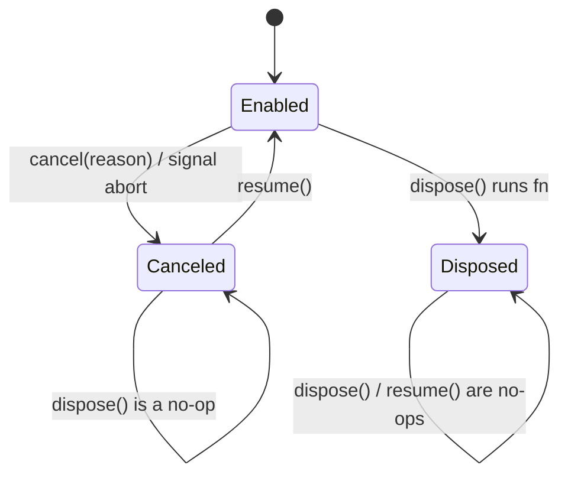

These helpers build on JavaScript's explicit resource management (`using` and `await using`). `defer` and
`deferSync` register cleanup code that runs when the current scope ends, and you can cancel it, for example
with an `AbortSignal`. `makeDisposable` makes an existing object, such as a database client or a connection,
work with `await using`.

```ts
import {
  defer,
  deferSync,
  makeDisposable,
  DisposedSymbol,
  EnabledSymbol,
  CanceledSymbol,
  CancelReasonSymbol,
} from "@xtandard/lib";
```

## `using` and `await using`

A `using` declaration binds a value that has a `[Symbol.dispose]()` method. When the enclosing block exits,
whether it returns, finishes normally or throws, that method is called. `await using` does the same with
`[Symbol.asyncDispose]()` and awaits it. If a scope declares several resources, they are disposed in reverse
order (last declared, first disposed).

```ts
async function job() {
  await using a = defer(async () => console.log("dispose a"));
  await using b = defer(() => console.log("dispose b"));
  using c = deferSync(() => console.log("dispose c"));
  console.log("body");
}

await job(); // body, dispose c, dispose b, dispose a
```

It's like `try/finally`, but the cleanup sits next to the code that acquires the resource, and it still runs
if code added later returns early.

:::note[Toolchain support]
You need TypeScript 5.2 or later with `esnext.disposable` (or `esnext`) in `compilerOptions.lib`. TypeScript
compiles `using` to plain JavaScript when your `target` is below `esnext`. Otherwise, the runtime must support
the syntax natively; Bun does, for example.
:::

## `defer`

`defer(fn, options?)` returns an async disposable that runs `fn` when it is disposed. `fn` may be sync or
async. Unlike a plain `{ [Symbol.asyncDispose]: fn }` object, it:

- runs `fn` **at most once**, even if disposed twice;
- can be **cancelled** with `cancel(reason?)`, which makes disposal do nothing, and re-enabled with `resume()`;
- can be cancelled by an **`AbortSignal`**;
- exposes its state: `enabled`, `disposed`, `canceled`, `cancelReason`.

### Cancel on success: rollback unless committed

The most common pattern is cleanup that should run only if something goes wrong:

```ts
async function transfer(db: Db, from: string, to: string, amount: number) {
  await db.query("BEGIN");
  await using rollback = defer(async () => {
    await db.query("ROLLBACK");
  });

  await db.query("UPDATE accounts SET balance = balance - $1 WHERE id = $2", [amount, from]);
  await db.query("UPDATE accounts SET balance = balance + $1 WHERE id = $2", [amount, to]);
  await db.query("COMMIT");

  rollback.cancel("committed"); // success: nothing to undo
}
```

If either `UPDATE` throws, the scope exits early and the rollback runs. If the function reaches the end,
`cancel` turns disposal into a no-op.

### Options

| Option      | Type                | Effect                                                                                                                                                  |
| ----------- | ------------------- | ------------------------------------------------------------------------------------------------------------------------------------------------------- |
| `signal`    | `AbortSignal`       | When the signal aborts, the deferred is cancelled with `signal.reason` as the reason. If the signal has already aborted, the deferred starts cancelled. |
| `onDispose` | `() => void`        | Called after `fn` completes. Not called when cancelled, when already disposed, or when `fn` throws.                                                     |
| `onCancel`  | `(reason?) => void` | Called each time the deferred is cancelled, by `cancel()` or by the signal.                                                                             |

```ts
const controller = new AbortController();

const cleanup = defer(() => removeTempFiles(), {
  signal: controller.signal,
  onCancel: (reason) => console.log("kept files:", reason),
});

controller.abort("user wants to inspect them"); // logs "kept files: user wants to inspect them"
cleanup.canceled; // true
cleanup.cancelReason; // "user wants to inspect them"
await cleanup.dispose(); // no-op
```

### State and lifecycle



| Member            | Meaning                                                                                               |
| ----------------- | ----------------------------------------------------------------------------------------------------- |
| `dispose()`       | Run `fn` now, if enabled and not yet disposed. The same function is used for `[Symbol.asyncDispose]`. |
| `cancel(reason?)` | Disable; stores `reason` and calls `onCancel`.                                                        |
| `resume()`        | Re-enable after a cancel and clear the reason. Does nothing after disposal.                           |
| `enabled`         | `true` while disposing would run `fn` (not cancelled and not disposed).                               |
| `disposed`        | `true` once `fn` has started.                                                                         |
| `canceled`        | `true` after `cancel()` or a signal abort, until `resume()`.                                          |
| `cancelReason`    | The last cancel reason, or `undefined`.                                                               |

`resume()` also undoes a cancel caused by the signal. The deferred doesn't check the signal again.

:::caution[Errors]
`disposed` becomes `true` _before_ `fn` runs, so a cleanup that throws is not retried. The error propagates
out of `dispose()` or out of the `await using` scope. When several resources are disposed and one throws, the
others are still disposed (that is how `using` works).
:::

## `deferSync`

`deferSync(fn, options?)` is the synchronous version for `using`. It has the same options, members and
symbols, but implements `[Symbol.dispose]` instead of `[Symbol.asyncDispose]`, and `dispose()` returns
`void`. Use it when the cleanup is synchronous and the surrounding function isn't async:

```ts
function render(canvas: CanvasRenderingContext2D) {
  canvas.save();
  using restore = deferSync(() => canvas.restore());

  canvas.translate(10, 10);
  drawScene(canvas); // canvas.restore() runs even if this throws
}
```

`deferSync` does not await `fn`. If `fn` returns a promise, disposal doesn't wait for it, so use `defer` for
async cleanup.

## `makeDisposable`

`makeDisposable(resource, options?)` adds a `[Symbol.asyncDispose]` method to an existing object, so you can
bind it with `await using`. It returns a `Promise` of the **same object** (not a wrapper or Proxy), typed as
`T` plus the dispose method and a `[DisposedSymbol]` getter.

```ts
await using client = await makeDisposable(createClient({ url: REDIS_URL }), {
  onInit: (c) => c.connect(),
  onDispose: (c) => c.quit(),
});

await client.set("key", "value");
// client.quit() runs when the scope ends
```

| Option      | Type                               | Effect                                                                                 |
| ----------- | ---------------------------------- | -------------------------------------------------------------------------------------- |
| `onInit`    | `(resource) => MaybePromise<void>` | Awaited before `makeDisposable` resolves. If it throws, the returned promise rejects.  |
| `onDispose` | `(resource) => MaybePromise<void>` | Run on dispose, at most once.                                                          |
| `overwrite` | `boolean` (default `false`)        | Allow an object that is already async-disposable. Otherwise this throws a `TypeError`. |

Things to know:

- **It mutates the object.** The two symbol properties are added to `resource` directly, as non-enumerable
  properties. They don't show up in `Object.keys`, `for...in`, spread or `JSON.stringify`, and identity
  checks (`===`, `Map` keys) still work.
- **Calling it twice throws** `TypeError("Resource is already disposable. Pass { overwrite: true } to replace.")`.
  With `overwrite: true`, the handler is replaced, the disposed state is reset, and `onInit` runs again.
- If `onDispose` throws, the resource is still marked as disposed, and the error propagates.

## State symbols

`defer`, `deferSync` and `makeDisposable` expose their state through exported symbols as well as through
named properties:

| Symbol               | Available on                           | Value                   |
| -------------------- | -------------------------------------- | ----------------------- |
| `DisposedSymbol`     | `defer`, `deferSync`, `makeDisposable` | `true` once disposed    |
| `EnabledSymbol`      | `defer`, `deferSync`                   | same as `.enabled`      |
| `CanceledSymbol`     | `defer`, `deferSync`                   | same as `.canceled`     |
| `CancelReasonSymbol` | `defer`, `deferSync`                   | same as `.cancelReason` |

The symbols exist because `makeDisposable` adds state to _your_ object, which may already have a `disposed`
or `enabled` property. A symbol key can't collide with those. Use the symbols in generic code that checks
whether any of these resources has been disposed:

```ts
const conn = await makeDisposable(openConnection(), { onDispose: (c) => c.close() });

conn[DisposedSymbol]; // false
await conn[Symbol.asyncDispose]();
conn[DisposedSymbol]; // true
```
