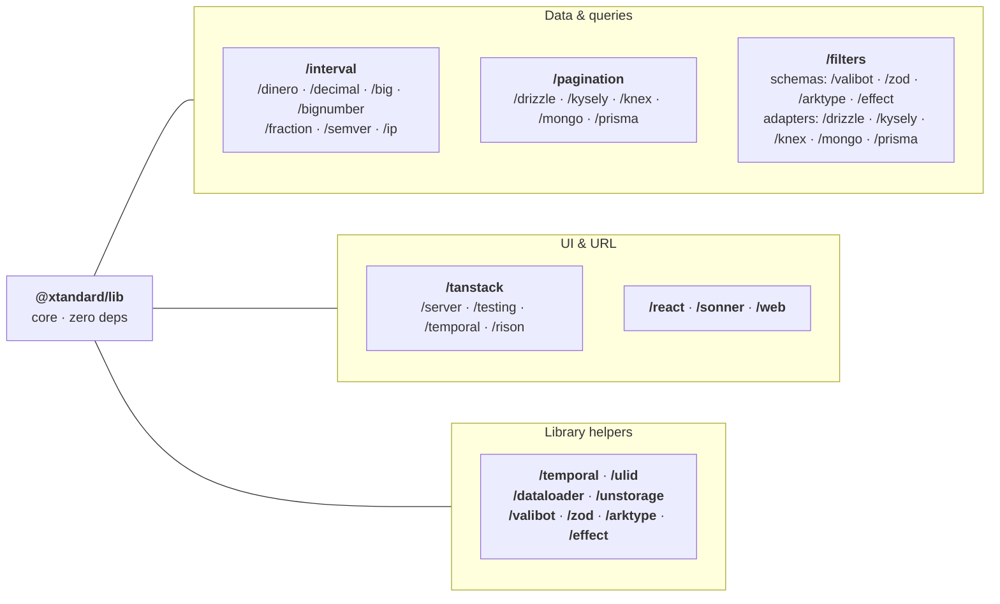

{/* The home page: written for the site; its content follows the root README.
scripts/sync.ts replaces the BASE and REPO tokens. */}

import { Card, CardGrid, LinkCard, Tabs, TabItem } from "@astrojs/starlight/components";

```sh
npm install @xtandard/lib
```

One package, many entry points. Import only what you need: every entry point is tree-shakeable,
and each one's dependencies are **optional peer dependencies**, installed only when you use it.

## A taste of each

<Tabs syncKey="home-area">
<TabItem label="Core">

```ts
import { tryCatch, collect, defer } from "@xtandard/lib";

const [config, parseError] = tryCatch(() => JSON.parse(raw)); // sync in → sync out
const [user, fetchError] = await tryCatch(fetchUser(id)); // promise in → promise out

const rows = await collect(streamRows()); // drain any iterable or async iterable

async function job() {
  await using _ = defer(() => console.log("cleanup")); // runs when the scope ends
}
```

Errors as values, async primitives (`Completer`, `AsyncChannel`), iterables, disposables, type
guards and string helpers. Zero dependencies. [Explore the core →](@BASE@/core/)

</TabItem>
<TabItem label="Interval">

```ts
import { NumberInterval } from "@xtandard/lib/interval";

const hours = NumberInterval.closedOpen(9, 17); // [9,17)
hours.contains(17); // false: the end is open
hours.union(NumberInterval.closedOpen(17, 20))?.toString(); // "[9,20)"
hours.intersection(NumberInterval.closed(12, 20)).toString(); // "[12,17)"
NumberInterval.closed(3, 10).difference(NumberInterval.open(4, 6)); // [3,4] ∪ [6,10]
```

Guava-style ranges with exact open/closed boundaries over numbers, dates, Temporal, money,
decimals, fractions, semver and IP addresses. [Intervals →](@BASE@/interval/) ·
[Playground →](@BASE@/playground/interval/)

</TabItem>
<TabItem label="Pagination">

```ts
import { createPaginator } from "@xtandard/lib/pagination";

const users = createPaginator({
  fetchOffset: async ({ limit, offset }) => ({ items: await db.users.list({ limit, offset }) }),
  fetchCursor: async ({ limit, cursor, direction }) => ({
    items: await db.users.seek({ after: cursor?.id, limit, direction }),
  }),
  cursor: { fromItem: (u) => ({ id: u.id }) },
});

// Any input style works against the same paginator.
const page2 = await users.paginate({ type: "page", page: 2, pageSize: 20 });
const next = await users.paginate({ type: "cursor", limit: 20, cursor: page2.pageInfo.endCursor });
```

Cursor and offset pagination, keyset helpers, pluggable cursor codecs and adapters for Drizzle, Kysely,
Knex, Mongo and Prisma. [Pagination →](@BASE@/pagination/)

</TabItem>
<TabItem label="Filters">

```ts
import * as v from "valibot";
import { FiltersRequestSchema } from "@xtandard/lib/filters/valibot";
import { buildWhere, textField, numberField } from "@xtandard/lib/filters/drizzle";

// 1. Validate the untrusted request.
const filters = v.parse(FiltersRequestSchema, [
  { field: "name", filter: { kind: "text", operator: "contains", value: "ada" } },
  { field: "amount", filter: { kind: "number", operator: "between", from: 10, to: 100 } },
]);

// 2. Allow-list the fields, then 3. build the WHERE.
const spec = { name: textField({ column: users.name }), amount: numberField({ column: users.amount }) };
const { where } = buildWhere({ spec, filters, resolveDate });
```

One portable filter model, compiled once and rendered for Drizzle, Kysely, Knex, Mongo or
Prisma. Swap the adapter import to switch databases. [Filters →](@BASE@/filters/) ·
[Playground →](@BASE@/playground/filters/)

</TabItem>
<TabItem label="URL state">

```tsx
import { useQueryState, parseAsInteger, parseAsString } from "@xtandard/lib/tanstack";

function SearchBox() {
  const [q, setQ] = useQueryState("q", parseAsString.withDefault(""));
  return <input value={q} onChange={(e) => setQ(e.target.value)} />;
}

function NextPage() {
  const [page, setPage] = useQueryState("page", parseAsInteger.withDefault(1));
  return <button onClick={() => setPage((p) => p + 1)}>Next</button>;
}
```

nuqs-style typed URL state for TanStack Router, with framework-free parsers for the server, a
testing adapter, and Temporal and rison codecs. [TanStack URL state →](@BASE@/tanstack/)

</TabItem>
<TabItem label="Integrations">

```ts
import { toastStream } from "@xtandard/lib/sonner";
import { withCache } from "@xtandard/lib/unstorage";
import { ulid } from "@xtandard/lib/ulid";

// A live toast that follows an async generator from start to finish.
await toastStream(() => importUsers(rows), {
  loading: "Importing users...",
  streaming: ({ count, latest }) => `Imported ${count}: ${latest.name}`,
  success: ({ count }) => `Imported ${count} users`,
  error: (error) => `Import failed: ${String(error)}`,
});

// Cache any async function in unstorage.
const getRates = withCache(fx.fetchRates, { storage, prefix: "fx", ttl: 3600 });

const id = ulid(); // "01M7S7D8JQNAS4327M1E3VSVN5"
```

Small, focused helpers for React, Sonner, Temporal, ULID, DataLoader, unstorage, the browser and
validation libraries. [Integrations →](@BASE@/integrations/web/)

</TabItem>
</Tabs>

## Why xtandard

<CardGrid>
  <Card title="Zero-dependency core" icon="seti:typescript">
    The bare `@xtandard/lib` import uses only standard JavaScript, so the same code runs in Node,
    Bun, Deno, browsers and edge runtimes.
  </Card>
  <Card title="Pay only for what you import" icon="puzzle">
    Each integration is its own entry point with optional peers. Importing the filters never pulls
    in React; importing the core pulls in nothing. [Entry points →](@BASE@/guides/entry-points/)
  </Card>
  <Card title="As synchronous as your input" icon="rocket">
    `tryCatch`, `collect`, `createPaginator` and friends return plain values for sync input and
    Promises for async input, and their types say which.
    [Sync/async-adaptive APIs →](@BASE@/guides/sync-async-adaptive/)
  </Card>
  <Card title="Safe on both sides" icon="approve-check">
    The core, `/interval`, `/pagination`, `/filters` and `/tanstack/server` are frontend-safe, so
    the filter model and its URL codec can be shared between your server and your browser bundle.
  </Card>
</CardGrid>

## The package at a glance

Every box is an import path. The core is standalone; each family adds optional entry points for the
libraries it works with.



## Learn by building

<CardGrid>
  <LinkCard
    title="A filterable, paginated list"
    href="@BASE@/tutorials/filterable-list/"
    description="Filters, sorting and cursor pagination from the URL to the database and back."
  />
  <LinkCard
    title="Streaming results into the UI"
    href="@BASE@/tutorials/streaming-ui/"
    description="An async generator rendered live in React and followed by a toast."
  />
  <LinkCard
    title="Availability with intervals"
    href="@BASE@/tutorials/booking-ranges/"
    description="Free slots, overlaps and merged bookings with Interval<T>."
  />
  <LinkCard
    title="All tutorials"
    href="@BASE@/tutorials/"
    description="What each tutorial covers and what you need to follow it."
  />
</CardGrid>

## Try it in the browser

<CardGrid>
  <LinkCard
    title="Filters playground"
    href="@BASE@/playground/filters/"
    description="Edit a filter and see the compiled AST, SQL, Mongo and Prisma output live."
  />
  <LinkCard
    title="Interval playground"
    href="@BASE@/playground/interval/"
    description="Parse, intersect, span and merge intervals interactively."
  />
</CardGrid>
