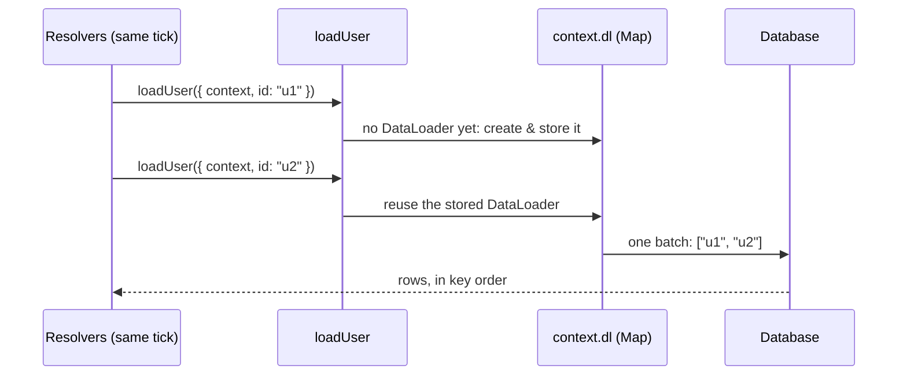

`@xtandard/lib/dataloader` wraps [DataLoader](https://github.com/graphql/dataloader) so you can declare a loader once, at module level, and still get a fresh cache per request. Use it to remove N+1 queries in GraphQL resolvers or any code that loads the same kind of record from many places during one request.

```sh
npm install @xtandard/lib dataloader
```

```ts
import { createLoader } from "@xtandard/lib/dataloader";
import { prepareLoaderResult } from "@xtandard/lib"; // core, zero deps
```

`dataloader` (v2) is an optional peer dependency.

## Why a factory

A DataLoader must not outlive a request: its cache would leak data between users and go stale. The usual fix is to construct every loader in the per-request context, which means listing them all in one place. `createLoader` flips that around: it returns a plain async function, and the actual `DataLoader` instance is created lazily, the first time the function is called with a given context, and stored **in that context**.



## `createLoader`

```ts
import { createLoader } from "@xtandard/lib/dataloader";
import { prepareLoaderResult } from "@xtandard/lib";

type User = { id: string; name: string };
type Context = { dl: Map<symbol, unknown> };

export const loadUser = createLoader<User | null, Context>(async ({ context, keys }) => {
  const rows = await db.user.findMany({ where: { id: { in: [...keys] } } });
  return prepareLoaderResult({ keys, results: rows, defaultValue: null });
});

// Per request: a fresh Map
const context: Context = { dl: new Map() };

// Calls in the same tick are batched into one findMany(["u1", "u2"])
const [ada, grace] = await Promise.all([
  loadUser({ context, id: "u1" }),
  loadUser({ context, id: "u2" }),
]);

await loadUser({ context, id: "u1" }); // cached for this context: no query
await loadUser({ context: { dl: new Map() }, id: "u1" }); // another request: queries again
```

The type parameters are `createLoader<T, Ctx, K = string, C = string>`: the value type, your context type, the key type, and the cache-key type. The batch function receives `{ context, keys }` and must return a promise of an array **with one entry per key, in the same order as `keys`**: that is DataLoader's contract, and `prepareLoaderResult` exists to satisfy it.

Each `createLoader` call gets its own private `Symbol` as the key in the context's map, so any number of loaders can share one `Map` without colliding.

### `CreateLoaderOptions`

| Option         | Default           | Description                                                               |
| -------------- | ----------------- | ------------------------------------------------------------------------- |
| `getCache`     | `(ctx) => ctx.dl` | Where the loader's `Map<symbol, unknown>` lives in your context.          |
| `maxBatchSize` | `300`             | Split larger batches into several calls (keeps `IN (...)` lists bounded). |
| `cacheKeyFn`   | identity          | Map a key to a primitive cache key. Needed for object keys.               |

If your context keeps loaders somewhere other than `dl`:

```ts
type AppContext = { loaders: Map<symbol, unknown>; user: Session };

const loadOrg = createLoader<Org | null, AppContext>(fetchOrgs, {
  getCache: (ctx) => ctx.loaders,
  maxBatchSize: 100,
});
```

Object keys are compared by reference, so two equal-looking objects would be fetched twice. Give them a string cache key:

```ts
type TagKey = { object: string; id: string };

const loadTags = createLoader<Tag[], Context, TagKey>(async ({ keys }) => fetchTags(keys), {
  cacheKeyFn: (key) => `${key.object}::${key.id}`,
});
```

:::note
The batch function receives the `context` from the call that **created** the loader for that request. That's the same object for every call in a request, so it's safe to read the session or a DB transaction from it.
:::

## `prepareLoaderResult` (from the core)

A `WHERE id IN (...)` query returns rows in any order, skips ids that don't exist, and may return several rows per key. `prepareLoaderResult` (in the zero-dependency core, `@xtandard/lib`) maps them back to the order of `keys`. It is async, so you can `return` it directly from the batch function.

By default each row's key is read from `row.id`, falling back to `row.uid`; pass `getKey` otherwise. Missing keys become `undefined`, or `defaultValue` if you give one.

```ts
// One row per key, missing → null
return prepareLoaderResult({ keys, results: rows, defaultValue: null });

// Many rows per key (e.g. a user's photos) → one array per key, [] when none
const loadPhotos = createLoader<Photo[], Context>(async ({ keys }) => {
  const rows = await db.photo.findMany({ where: { userId: { in: [...keys] } } });
  return prepareLoaderResult({ keys, results: rows, mode: "many", getKey: (row) => row.userId });
});

// Transform rows (sync or async) on the way out
return prepareLoaderResult({
  keys,
  results: rows,
  mapValue: async (row) => ({ ...row, org: await loadOrg({ context, id: row.orgId }) }),
});
```

Keys are matched with a `Map`, so types must agree: a numeric `row.id` will not match a string key. For that case, or for composite keys, pass `keyToString` to compare both sides as strings:

```ts
return prepareLoaderResult({
  keys, // TagKey[]
  results: rows,
  getKey: (row) => ({ object: row.object, id: row.objectId }),
  keyToString: (key) => `${key.object}::${key.id}`,
});
```

## See also

- API reference: [`createLoader`](@BASE@/api/dataloader/functions/createloader/), [`CreateLoaderOptions`](@BASE@/api/dataloader/interfaces/createloaderoptions/), [`prepareLoaderResult`](@BASE@/api/core/functions/prepareloaderresult/)
- Source: [`dataloader-utils.ts`](@REPO@/blob/main/src/dataloader-utils.ts), [`prepare-loader-result.ts`](@REPO@/blob/main/src/prepare-loader-result.ts)
