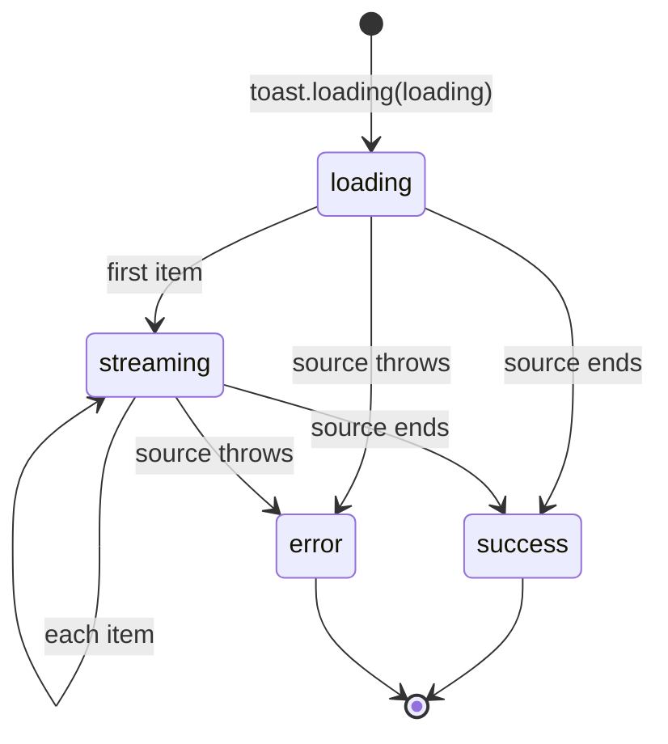

`@xtandard/lib/sonner` is `toast.promise` for streams. Hand it a generator, async iterable, array or `AsyncChannel` and one [Sonner](https://sonner.emilkowal.ski/) toast follows it: a loading message, an update per item, then a success or error message. Reach for it for imports, uploads, batch jobs: anything that reports progress as it goes.

```sh
npm install @xtandard/lib sonner react
```

```ts
import { toastStream, toastStreamAsync } from "@xtandard/lib/sonner";
```

`sonner` (v2) and `react` are optional peer dependencies. You still need Sonner's `<Toaster />` mounted somewhere in your app for the toasts to appear.



All updates go to the **same toast id**, so the user sees one toast change state rather than a pile of toasts.

## `toastStream`: await the result

`toastStream(source, options)` returns a promise of `{ items, returnValue }`: every item the source produced, plus the generator's `return` value (`undefined` for plain iterables). Use it when the caller needs the results before continuing.

```ts
import { toastStream } from "@xtandard/lib/sonner";

async function* importUsers(rows: Row[]) {
  for (const row of rows) {
    yield await api.users.create(row); // { id, name }
  }
  return { imported: rows.length };
}

const { items, returnValue } = await toastStream(() => importUsers(rows), {
  loading: "Importing users...",
  streaming: ({ count, latest }) => `Imported ${count}: ${latest.name}`,
  success: ({ count, returnValue }) =>
    `Imported ${count} users (${returnValue.imported} confirmed)`,
  error: (error, partial) => `Import failed after ${partial.count} users: ${String(error)}`,
});
```

The source can be an instance (`importUsers(rows)`) or a factory (`() => importUsers(rows)`); both are consumed once.

When the source throws, the toast switches to the error message and **the promise rejects with the original error**. Wrap the call in `try`/`catch` (or [`tryCatch`](@BASE@/core/error-handling/)) if you don't want it to propagate:

```ts
import { tryCatch } from "@xtandard/lib";

const [result, error] = await tryCatch(
  toastStream(uploadFiles(files), { loading: "Uploading..." }),
);
```

## `toastStreamAsync`: don't wait

`toastStreamAsync` is the non-blocking variant, in the spirit of Sonner's `toast.promise(...).unwrap()`. It returns `{ id, unwrap }` immediately: `id` is Sonner's toast id (for `toast.dismiss(id)`), and `unwrap()` resolves to the same `{ items, returnValue }`.

```ts
import { toastStreamAsync } from "@xtandard/lib/sonner";

const imported = toastStreamAsync(importUsers(rows), { loading: "Importing users..." });
// ...carry on; await only if the result matters
const { items } = await imported.unwrap();
```

`unwrap()` rejects with the stream's error after the error toast is shown. If you never call it, a failure only shows the toast: there is no unhandled rejection.

## Options

Every message option takes a string, any React node, or a function (sync or async) that receives the current data. Each can also return `{ message, ...toastOptions }` to set Sonner options (`description`, `action`, `duration`, …) for that state only.

| Option      | Called with                                                    | Default message            |
| ----------- | -------------------------------------------------------------- | -------------------------- |
| `loading`   | nothing                                                        | `"Processing..."`          |
| `streaming` | `{ count, latest, items }` after each item                     | `"Streaming... (N items)"` |
| `success`   | `{ count, items, returnValue }`                                | `"Complete! N items"`      |
| `error`     | `(error, { count, items })`: items received before the failure | `"Stream failed"`          |

```ts
await toastStream(steps, {
  loading: "Starting...",
  streaming: ({ latest, count }) => ({
    message: `Running ${latest}`,
    description: `${count} of ${steps.length}`,
  }),
  success: { message: "All steps done", duration: 2000 },
});
```

Non-message options:

- `onItem(item, count)`: side effect per item, called before the toast updates.
- `finally()`: runs when the stream ends, success or failure, **before** the success/error toast is shown. It may be async; it is awaited.
- `delay`: artificial pacing in milliseconds. A number applies to every phase; `{ first, items, result }` sets the wait before the first item, between items, and before the final message. Synchronous sources (arrays, sync generators) finish within one tick, so without a delay the user only sees the end state:

  ```ts
  await toastStream(["parse", "validate", "save"], {
    loading: "Starting...",
    streaming: ({ latest }) => `Running ${latest}`,
    success: ({ count }) => `Completed ${count} steps`,
    delay: { first: 300, items: 200, result: 150 },
  });
  ```

- Any other Sonner toast option at the top level (`position`, `duration`, `className`, …) is passed through. A top-level `description` is not accepted; return one from a state's `{ message, description }` instead.

## See also

- [React](@BASE@/integrations/react/): `useStream` / `StreamRenderer` render the same sources inline.
- [Async](@BASE@/core/async/): `AsyncChannel` and the other stream sources.
- API reference: [`toastStream`](@BASE@/api/sonner/functions/toaststream/), [`toastStreamAsync`](@BASE@/api/sonner/functions/toaststreamasync/)
- Source: [`toast-stream.ts`](@REPO@/blob/main/src/toast-stream.ts)
