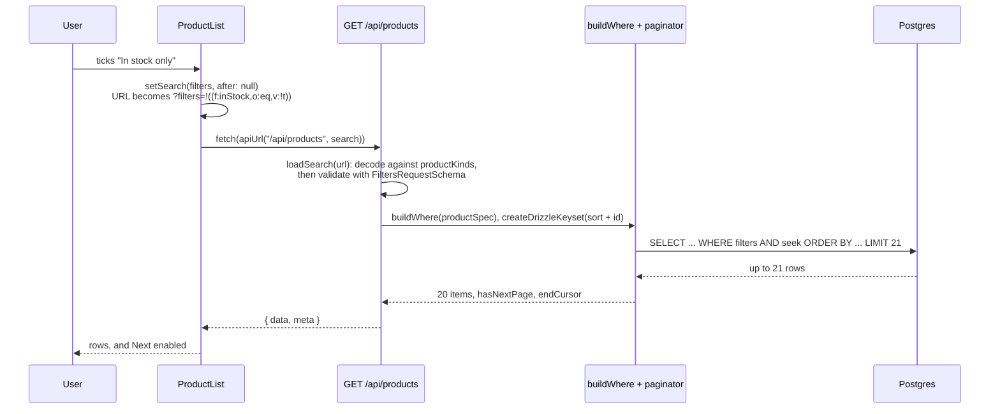

In this tutorial you build a "products" list that people can filter, sort and page through, with all of
that state kept in the URL so it survives a reload and can be shared as a link. The server validates the
request, turns it into a Drizzle `WHERE`, and pages through the result with keyset (cursor) pagination.
The frontend reads and writes the same state with `@xtandard/lib/tanstack`.

By the end you will have:

- one shared module that defines the filterable fields and the URL format, used by both the browser and
  the server;
- a `GET /api/products` endpoint that only filters and sorts on fields you allow;
- a React component whose filters, sort and page cursor all live in the address bar, in a short, readable
  form such as `?filters=!((f:inStock,o:eq,v:!t))&sort=priceCents:asc`.

```sh
npm install @xtandard/lib drizzle-orm valibot @js-temporal/polyfill @effective/rison
npm install react @tanstack/react-router @tanstack/react-query
```

`valibot` and `@js-temporal/polyfill` are the peers of `@xtandard/lib/filters/valibot`; `@effective/rison`
writes the compact URL form. You need a Postgres database with Drizzle already set up as `db`.

## 1. Define the table

Start with a plain Drizzle table. Prices are integer cents, so they compare exactly. The `id` column is
unique, so it can break ties when two products have the same price.

```ts title="src/db/schema.ts"
import { boolean, integer, pgTable, serial, text, timestamp } from "drizzle-orm/pg-core";

export const products = pgTable("products", {
  id: serial("id").primaryKey(),
  name: text("name").notNull(),
  category: text("category", { enum: ["books", "games", "music"] }).notNull(),
  priceCents: integer("price_cents").notNull(),
  inStock: boolean("in_stock").notNull(),
  createdAt: timestamp("created_at", { withTimezone: true, mode: "date" }).notNull(),
});

export type Product = typeof products.$inferSelect;
```

## 2. Share the field list and the URL format

The browser and the server must agree on two things: which fields can be filtered (and their kind), and
how the list state is written in the URL. Put both in a module with no database or React imports, so
both sides can import it.

```ts title="src/products/shared.ts"
import { decode, encode } from "@effective/rison";
import {
  createFilterUrlCodec,
  type FieldKindSpec,
  type FiltersRequest,
} from "@xtandard/lib/filters";
import { parseAsCodec, parseAsString, type ValueCodec } from "@xtandard/lib/tanstack/server";

// public field name → filter kind. Anything else is dropped.
export const productKinds = {
  name: "text",
  category: "enum",
  priceCents: "number",
  inStock: "boolean",
} satisfies FieldKindSpec;

const filterUrl = createFilterUrlCodec({ kinds: productKinds });

// FiltersRequest ⇄ compact Rison text, e.g. !((f:category,o:iA,vs:!(games)))
const filtersCodec: ValueCodec<FiltersRequest> = {
  encode: (filters) => encode(filterUrl.encodeFilters(filters)),
  decode: (token) => filterUrl.decodeFilters(decode(token)),
};

// One parser per query key. The same map drives the React hook, the API URL and the server loader.
export const productSearch = {
  filters: parseAsCodec(filtersCodec).withDefault([]),
  sort: parseAsString.withDefault("createdAt:desc"),
  after: parseAsString, // cursor: rows after this one
  before: parseAsString, // cursor: rows before this one
};
```

A filter in code is a verbose, typed object, for example
`{ field: "category", filter: { kind: "enum", operator: "inArray", values: ["games"] } }`.
[`createFilterUrlCodec`](@BASE@/api/filters/functions/createfilterurlcodec/) shortens it for the URL:
it drops `kind` (decoding restores it from `productKinds`) and abbreviates keys and operators
(`inArray` becomes `iA`). Decoding drops any leaf whose field is not in `productKinds`, whose operator
code is unknown, or whose value has the wrong type.

[`parseAsCodec`](@BASE@/api/tanstack/server/functions/parseascodec/) turns that codec into a URL
parser. If decoding throws (a hand-edited, broken `?filters=`), the parser returns `null`, so the key
falls back to its default (`[]`) instead of crashing the page.

:::note
The parsers come from `@xtandard/lib/tanstack/server`, which has no React dependency. That is what lets
the server import this file too.
:::

## 3. Declare the server-side allow-list

On the server, map each public field to a Drizzle column. The spec builders check the column type
against the kind at compile time: `numberField` only accepts a column whose value is a `number`.

```ts title="src/products/server.ts"
import { booleanField, enumField, numberField, textField } from "@xtandard/lib/filters/drizzle";
import { products } from "../db/schema";

const productSpec = {
  name: textField({ column: products.name }),
  category: enumField({ column: products.category }),
  priceCents: numberField({ column: products.priceCents }),
  inStock: booleanField({ column: products.inStock }),
};

// The columns a client may sort by. `id` is not here: the server always appends it as a tiebreaker.
const sortColumns = {
  name: products.name,
  priceCents: products.priceCents,
  createdAt: products.createdAt,
};
```

The spec is the security boundary. Clients send public field names. Only names that are in the spec,
with a matching kind, reach the query, and every value is sent as a bound parameter. A client cannot
filter on a column you did not list.

## 4. Read and validate the request

Parse the query string with the same `productSearch` map, using
[`createLoader`](@BASE@/api/tanstack/server/functions/createloader/). Then validate the decoded filters
with the ready-made valibot schema before they reach the adapter. The codec has already removed fields
that are not allowed, but validating is still the rule for anything that crosses a trust boundary.

```ts title="src/products/server.ts"
import * as v from "valibot";
import { FiltersRequestSchema } from "@xtandard/lib/filters/valibot";
import { buildWhere } from "@xtandard/lib/filters/drizzle";
import { createLoader } from "@xtandard/lib/tanstack/server";
import { productSearch } from "./shared";

const loadSearch = createLoader(productSearch);

// inside the request handler:
const search = loadSearch(url); // { filters, sort, after, before }, with defaults applied
const parsed = v.safeParse(FiltersRequestSchema, search.filters);
if (!parsed.success) return Response.json({ error: "Invalid filters" }, { status: 400 });

const { where } = buildWhere({ spec: productSpec, filters: parsed.output });
```

`buildWhere` compiles the filters with the portable compiler and renders the result to a Drizzle `SQL`.
For `category in (games, books)`, a price between 1000 and 5000, and a name containing "board", it
produces:

```sql
("products"."category" in ($1, $2)
  and ("products"."price_cents" >= $3 and "products"."price_cents" <= $4)
  and "products"."name" ilike $5)
-- params: ["games", "books", 1000, 5000, "%board%"]
```

`between` becomes `>= AND <=`, never SQL `BETWEEN`. `contains` becomes `ILIKE '%…%'`, with `%` and `_`
in the user's text escaped. If you want to see the driver-neutral form, call `compileFilters` from
`@xtandard/lib/filters` yourself: it returns the `CompiledWhere` tree that every adapter renders. The
[compiler and adapters](@BASE@/filters/adapters/) page explains how it is lowered.

:::tip
This tutorial has no `date` filters. If you add a `dateField`, pass a `resolveDate` function to
`buildWhere`; a date preset without one throws. See
[the `date` kind is injected](@BASE@/filters/#the-date-kind-is-injected).
:::

## 5. Sort with a keyset and paginate

Keyset pagination finds the next page by value ("rows after price 2000, id 3"), not by position, so it
stays correct while rows are added and it is fast at any depth. It needs a sort order that is
**unique**, so always end it with `id`.

Turn the `sort` param into that order, keeping only allowed fields, then build a keyset with
[`createDrizzleKeyset`](@BASE@/api/filters/drizzle/functions/createdrizzlekeyset/) and a paginator with
[`createPaginator`](@BASE@/api/pagination/functions/createpaginator/):

```ts title="src/products/server.ts"
import { parseSortParam } from "@xtandard/lib/filters";
import { combineWhere, createDrizzleKeyset, createPaginator } from "@xtandard/lib/filters/drizzle";
import { db } from "../db";
import { products, type Product } from "../db/schema";

const { sort } = parseSortParam({ value: search.sort }); // "priceCents:asc" → [{ field, dir }]
const allowed = sort.filter((s) => Object.hasOwn(sortColumns, s.field));
const effective = allowed.length > 0 ? allowed : [{ field: "createdAt", dir: "desc" as const }];

const keyset = createDrizzleKeyset({
  sort: [...effective.map((s) => ({ key: s.field, order: s.dir })), { key: "id", order: "asc" }],
  columns: { ...sortColumns, id: products.id },
});

const paginator = createPaginator({
  maxLimit: 100,
  fetchCursor: async ({ limit, cursor, direction }) => ({
    items: await db
      .select()
      .from(products)
      .where(combineWhere(where, keyset.where(cursor, direction)))
      .orderBy(...keyset.orderBy(direction))
      .limit(limit),
  }),
  cursor: {
    // the cursor holds the values of the sort keys of a row, e.g. { priceCents: 2000, id: 3 }
    fromItem: (p: Product) =>
      Object.fromEntries(keyset.keys().map((key) => [key, p[key as keyof Product]])),
  },
});
```

How the pieces fit:

- `combineWhere` ANDs the filter `WHERE` with the keyset seek. On the first page the cursor is `null`,
  the seek is `undefined`, and only the filters apply.
- The fetcher receives `limit` with one extra row already added. The paginator uses that lookahead row to
  compute `hasNextPage` without a `COUNT(*)`, so fetch exactly `limit` rows.
- For a backward page (`direction: "backward"`), `keyset.orderBy` flips the order and the paginator
  reverses the rows back. Callers always see them in natural order.
- `fromItem` builds the cursor from the same keys as the sort. The default codec turns it into an opaque
  base64url token, and `createdAt` values come back as `Date`s when the token is decoded.

With `sort=priceCents:asc` and a cursor for `{ priceCents: 2000, id: 3 }`, the second page's query is:

```sql
select … from "products"
where (<filters>) and ("products"."price_cents" > $6
  or ("products"."price_cents" = $7 and "products"."id" > $8))
order by "products"."price_cents" asc, "products"."id" asc
limit $9
```

:::caution
`parseSortParam` accepts `asc`/`desc` in any case, reads a missing direction as `desc`, and drops an
entry with any other direction. It does not check field names.
The `Object.hasOwn` filter is what keeps the sort on allowed columns. Use `Object.hasOwn` rather than
`in`, which would also accept inherited names such as `toString`.
:::

## 6. Serve it

Put the steps together in one handler.
[`parsePaginationParams`](@BASE@/api/pagination/functions/parsepaginationparams/) reads `after`,
`before` and `limit` from the query string. `before` makes it a backward request, and the page size is
clamped to 100 by default. [`toRestEnvelope`](@BASE@/api/pagination/functions/torestenvelope/) shapes
the result as `{ data, meta }`.

```ts title="src/products/server.ts"
import { tryCatch } from "@xtandard/lib";
import { parsePaginationParams, toRestEnvelope } from "@xtandard/lib/filters";

const input = parsePaginationParams(url.searchParams, { defaultPageSize: 20, fallback: "cursor" });

// a tampered cursor throws while it is decoded: answer 400, not 500
const [result, error] = await tryCatch(async () => paginator.paginate(input));
if (error) return Response.json({ error: "Invalid pagination params" }, { status: 400 });

return Response.json(toRestEnvelope(result));
// → { data: Product[], meta: { hasNextPage, hasPreviousPage, startCursor, endCursor } }
```

`fallback: "cursor"` makes a request with no pagination params a first-page cursor request. This
paginator has no `fetchOffset`, so `?page=2` throws inside `paginate` and gets the same 400.

This is what happens when someone ticks "In stock only":



## 7. Use another database

Only the adapter changes. The shared module, validation, sort parsing, paginator and endpoint stay the
same. With **Kysely**, columns are string references, and the keyset comes from
`@xtandard/lib/pagination/kysely`:

```ts
import {
  booleanField,
  buildWhere,
  enumField,
  numberField,
  textField,
} from "@xtandard/lib/filters/kysely";
import { createKeysetSpec } from "@xtandard/lib/pagination";
import { toKyselyKeyset } from "@xtandard/lib/pagination/kysely";

const productSpec = {
  name: textField({ column: "products.name" }),
  category: enumField({ column: "products.category" }),
  priceCents: numberField({ column: "products.price_cents" }),
  inStock: booleanField({ column: "products.in_stock" }),
};
const kyselyKeyset = toKyselyKeyset({
  name: "products.name",
  priceCents: "products.price_cents",
  createdAt: "products.created_at",
  id: "products.id",
});

// per request:
const { where } = buildWhere({ spec: productSpec, filters: parsed.output });
const keyset = createKeysetSpec({
  sort: [...effective.map((s) => ({ key: s.field, order: s.dir })), { key: "id", order: "asc" }],
});

// fetchCursor:
let q = db.selectFrom("products").selectAll();
if (where) q = q.where(where);
const seek = kyselyKeyset.where(keyset.where(cursor, direction));
if (seek) q = q.where(seek);
for (const order of kyselyKeyset.orderBy(keyset.orderBy(direction))) q = q.orderBy(order);
return { items: await q.limit(limit).execute() };
```

Kysely returns rows with your Kysely column names, so make `cursor.fromItem` read the logical keys
(`priceCents`, `id`, …) from whatever those names are.

With **Prisma**, the adapter returns a plain `where` object and columns are model field names:

```ts
import {
  booleanField,
  buildWhere,
  enumField,
  numberField,
  textField,
} from "@xtandard/lib/filters/prisma";
import { toPrismaKeyset } from "@xtandard/lib/pagination/prisma";

const productSpec = {
  name: textField({ field: "name" }),
  category: enumField({ field: "category" }),
  priceCents: numberField({ field: "priceCents" }),
  inStock: booleanField({ field: "inStock" }),
};
const prismaKeyset = toPrismaKeyset({
  name: "name",
  priceCents: "priceCents",
  createdAt: "createdAt",
  id: "id",
});

// fetchCursor:
const seek = prismaKeyset.where(keyset.where(cursor, direction));
return {
  items: await prisma.product.findMany({
    where: { AND: [where, seek].filter((w) => w !== undefined) },
    orderBy: prismaKeyset.orderBy(keyset.orderBy(direction)),
    take: limit,
  }),
};
```

Here `contains` becomes `{ contains: "board", mode: "insensitive" }`. Prisma's `where` cannot express
every raw `LIKE` pattern, so some `like`/`ilike` filters throw. See the
[operator support matrix](@BASE@/filters/adapters/#operator-support-matrix).

## 8. Build the frontend

Wrap the app in the URL-state adapter, inside the TanStack Router tree.
`keepSubDelims` keeps Rison's `( ) , : !` readable in the address bar instead of percent-encoding them.

```tsx title="src/routes/__root.tsx"
import { QueryClient, QueryClientProvider } from "@tanstack/react-query";
import { createRootRoute, Outlet } from "@tanstack/react-router";
import { keepSubDelims, NuqsAdapter } from "@xtandard/lib/tanstack";

const queryClient = new QueryClient();

export const Route = createRootRoute({
  component: () => (
    <QueryClientProvider client={queryClient}>
      <NuqsAdapter serializeSearch={keepSubDelims}>
        <Outlet />
      </NuqsAdapter>
    </QueryClientProvider>
  ),
});
```

Now the list. [`useQueryStates`](@BASE@/api/tanstack/functions/usequerystates/) gives you the parsed
state and an atomic setter. [`createSerializer`](@BASE@/api/tanstack/server/functions/createserializer/)
builds the API URL from that state with the same parsers, so the request carries exactly what the
address bar shows. Default values (no filters, `createdAt:desc`) are left out of both.

```tsx title="src/products/ProductList.tsx"
import { useQuery } from "@tanstack/react-query";
import { describeColumnFilter, type FieldFilter, type FiltersRequest } from "@xtandard/lib/filters";
import type { RestEnvelope } from "@xtandard/lib/pagination";
import { useQueryStates } from "@xtandard/lib/tanstack";
import { createSerializer } from "@xtandard/lib/tanstack/server";
import { productSearch } from "./shared";

type Product = {
  id: number;
  name: string;
  category: string;
  priceCents: number;
  createdAt: string;
};

const apiUrl = createSerializer(productSearch);
const labels: Record<string, string> = {
  name: "Name",
  category: "Category",
  priceCents: "Price (cents)",
  inStock: "In stock",
};

// replace (or remove) the filter for one field
function withFilter(
  filters: FiltersRequest,
  field: string,
  filter: FieldFilter | null,
): FiltersRequest {
  const rest = filters.filter((f) => f.field !== field);
  return filter ? [...rest, { field, filter }] : rest;
}

export function ProductList() {
  const [search, setSearch] = useQueryStates(productSearch);
  const { filters, sort } = search;

  const { data, error, isFetching } = useQuery({
    queryKey: ["products", search],
    queryFn: async () => {
      const res = await fetch(apiUrl("/api/products", search));
      if (!res.ok) throw new Error(`Request failed: ${res.status}`);
      return (await res.json()) as RestEnvelope<Product>;
    },
    placeholderData: (previous) => previous, // keep the old page on screen while the next loads
  });

  // a new filter or sort invalidates the cursor: go back to the first page
  const setFilters = (next: FiltersRequest) =>
    setSearch({ filters: next, after: null, before: null });
  const current = (field: string) => filters.find((f) => f.field === field)?.filter;
  const nameFilter = current("name");

  return (
    <section>
      <input
        placeholder="Search by name"
        value={nameFilter?.operator === "contains" ? nameFilter.value : ""}
        onChange={(e) =>
          setFilters(
            withFilter(
              filters,
              "name",
              e.target.value ? { kind: "text", operator: "contains", value: e.target.value } : null,
            ),
          )
        }
      />
      <label>
        <input
          type="checkbox"
          checked={current("inStock") !== undefined}
          onChange={(e) =>
            setFilters(
              withFilter(
                filters,
                "inStock",
                e.target.checked ? { kind: "boolean", operator: "eq", value: true } : null,
              ),
            )
          }
        />
        In stock only
      </label>
      <select
        value={sort}
        onChange={(e) => setSearch({ sort: e.target.value, after: null, before: null })}
      >
        <option value="createdAt:desc">Newest</option>
        <option value="priceCents:asc">Price, low to high</option>
        <option value="priceCents:desc">Price, high to low</option>
        <option value="name:asc">Name</option>
      </select>

      <ul>
        {filters.map((columnFilter) => (
          <li key={columnFilter.field}>
            {describeColumnFilter({ columnFilter, label: labels[columnFilter.field] })}
            <button onClick={() => setFilters(withFilter(filters, columnFilter.field, null))}>
              ×
            </button>
          </li>
        ))}
      </ul>

      {error && <p role="alert">{error.message}</p>}
      <table aria-busy={isFetching}>
        <tbody>
          {data?.data.map((p) => (
            <tr key={p.id}>
              <td>{p.name}</td>
              <td>{p.category}</td>
              <td>{(p.priceCents / 100).toFixed(2)}</td>
            </tr>
          ))}
        </tbody>
      </table>

      <button
        disabled={!data?.meta.hasPreviousPage}
        onClick={() => setSearch({ before: data?.meta.startCursor ?? null, after: null })}
      >
        Previous
      </button>
      <button
        disabled={!data?.meta.hasNextPage}
        onClick={() => setSearch({ after: data?.meta.endCursor ?? null, before: null })}
      >
        Next
      </button>
    </section>
  );
}
```

[`describeColumnFilter`](@BASE@/api/filters/functions/describecolumnfilter/) writes the chip labels,
such as `Name contains "board"`, `In stock = true` and `Price (cents) between 1000 – 5000`. With those
three filters and a price sort, the address bar reads:

```
/products?filters=!((f:name,o:ct,v:board),(f:inStock,o:eq,v:!t),(f:priceCents,fr:1000,o:bt,to:5000))&sort=priceCents:asc
```

Reload the page or send the link to someone, and they see the same list.

:::note
Every keystroke in the search box changes `search`, and so the query key, so each one starts a request.
`limitUrlUpdates` only rate-limits writes to the URL; the hook state still updates immediately. If you
want fewer requests, debounce the input value before you call `setFilters`.
:::

## The complete server

Here is the whole endpoint, with steps 3 to 6 in one file. `src/products/shared.ts` from step 2 and
`src/products/ProductList.tsx` from step 8 are already complete as shown.

```ts title="src/products/server.ts"
import * as v from "valibot";
import { tryCatch } from "@xtandard/lib";
import { parsePaginationParams, parseSortParam, toRestEnvelope } from "@xtandard/lib/filters";
import { FiltersRequestSchema } from "@xtandard/lib/filters/valibot";
import {
  booleanField,
  buildWhere,
  combineWhere,
  createDrizzleKeyset,
  createPaginator,
  enumField,
  numberField,
  textField,
} from "@xtandard/lib/filters/drizzle";
import { createLoader } from "@xtandard/lib/tanstack/server";
import { db } from "../db";
import { products, type Product } from "../db/schema";
import { productSearch } from "./shared";

const productSpec = {
  name: textField({ column: products.name }),
  category: enumField({ column: products.category }),
  priceCents: numberField({ column: products.priceCents }),
  inStock: booleanField({ column: products.inStock }),
};

const sortColumns = {
  name: products.name,
  priceCents: products.priceCents,
  createdAt: products.createdAt,
};

const loadSearch = createLoader(productSearch);

export async function listProducts(req: Request): Promise<Response> {
  const url = new URL(req.url);
  const search = loadSearch(url);

  // filters: decoded against productKinds, then validated
  const parsed = v.safeParse(FiltersRequestSchema, search.filters);
  if (!parsed.success) return Response.json({ error: "Invalid filters" }, { status: 400 });
  const { where } = buildWhere({ spec: productSpec, filters: parsed.output });

  // sort: allowed fields only, `id` as the tiebreaker
  const { sort } = parseSortParam({ value: search.sort });
  const allowed = sort.filter((s) => Object.hasOwn(sortColumns, s.field));
  const effective = allowed.length > 0 ? allowed : [{ field: "createdAt", dir: "desc" as const }];
  const keyset = createDrizzleKeyset({
    sort: [...effective.map((s) => ({ key: s.field, order: s.dir })), { key: "id", order: "asc" }],
    columns: { ...sortColumns, id: products.id },
  });

  const paginator = createPaginator({
    maxLimit: 100,
    fetchCursor: async ({ limit, cursor, direction }) => ({
      items: await db
        .select()
        .from(products)
        .where(combineWhere(where, keyset.where(cursor, direction)))
        .orderBy(...keyset.orderBy(direction))
        .limit(limit),
    }),
    cursor: {
      fromItem: (p: Product) =>
        Object.fromEntries(keyset.keys().map((key) => [key, p[key as keyof Product]])),
    },
  });

  const input = parsePaginationParams(url.searchParams, {
    defaultPageSize: 20,
    fallback: "cursor",
  });
  const [result, error] = await tryCatch(async () => paginator.paginate(input));
  if (error) return Response.json({ error: "Invalid pagination params" }, { status: 400 });

  return Response.json(toRestEnvelope(result));
}

Bun.serve({ routes: { "/api/products": { GET: listProducts } } });
```

## Where next

- [Filters overview](@BASE@/filters/): every kind and operator, `and`/`or`/`not` trees with
  `buildFilterNode`, and the Zod, ArkType and Effect schemas.
- [Sorting, URLs & UI](@BASE@/filters/ui/): the compact codec in detail, and `ResourceMetadata`, which
  lets the backend describe its filterable fields so the UI can build itself.
- [Serving & cursors](@BASE@/pagination/serving/): cursor codecs (signed or encrypted tokens), GraphQL
  with `fromRelayArgs`, and the error contract.
- [Frontend & iteration](@BASE@/pagination/frontend/): infinite scroll with `infinitePaginationOptions`
  instead of Previous and Next buttons.
- [TanStack URL state](@BASE@/tanstack/): options such as `history`, `shallow` and
  `limitUrlUpdates`, and `validateSearch` for route loaders.
- [Filters playground](@BASE@/playground/filters/): try filters and see the compiled output.
